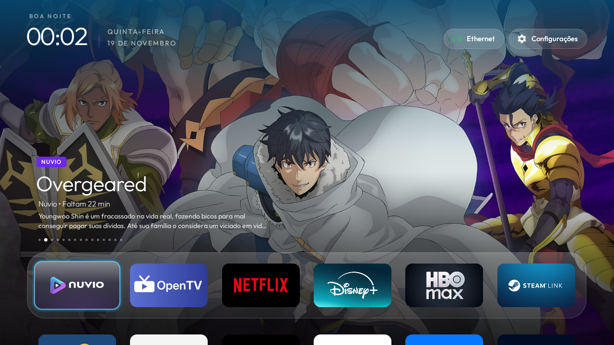
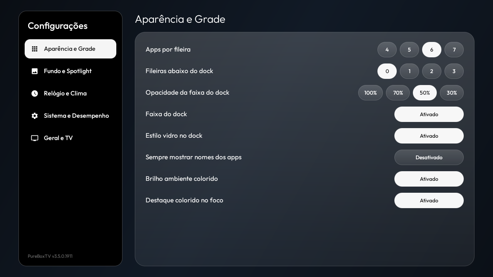
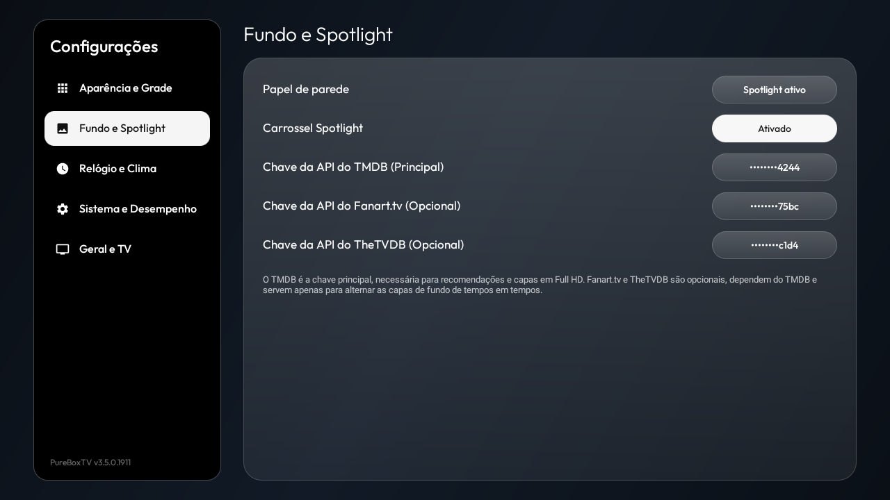
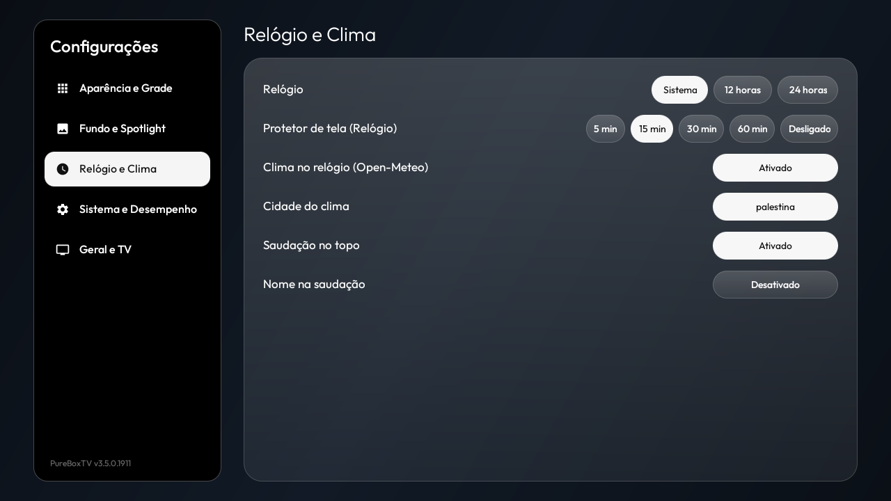
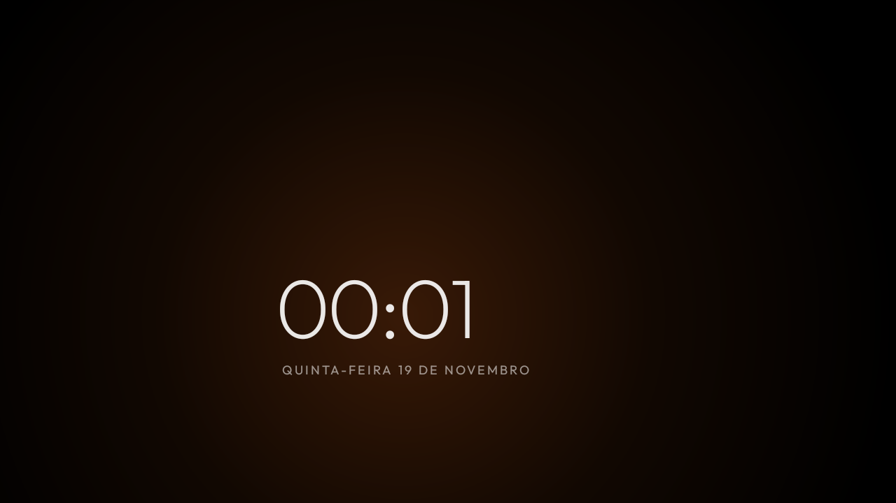

# PureBoxTV

**PureBoxTV** é um launcher leve, limpo e personalizável para **Android TV / TV Box**, criado como um fork customizado do excelente [Gathin23/cleanyourtv](https://github.com/Gathin23/cleanyourtv) (v3.5, licença MIT).

Projetado para oferecer visual moderno de cinema com **carrossel Spotlight em Full HD** e **baixíssimo consumo de memória RAM** — testado e otimizado no dia a dia em TV Boxes com apenas **1 GB de RAM** (Allwinner H616).

> 🇧🇷 **Português (BR)** abaixo | 🇺🇸 **[English summary](#english-summary)**



---

## O que foi modificado em relação ao `cleanyourtv` original

- **Carrossel Spotlight (até 15 itens)**
  - Recomendações reais filtradas pelos apps de streaming instalados (Netflix, Prime Video, Max, Disney+, Nuvio) + **Watch Next** e **Canais de Prévia** locais (como Jellyfin).
  - Capas de fundo **Full HD (1920×1080) sem texto** com rotação automática de artes a cada ciclo.
  - **Transição crossfade suave em 60 FPS** via `Choreographer` (funciona mesmo quando as escalas de animação do Android estão em `0`).
  - Limpeza automática de cache em disco para não ocupar espaço à toa na TV Box.

- **Otimização agressiva de RAM e CPU (ideal para TV Box de 1 GB)**
  - Janela deslizante de apenas **3 Bitmaps decodificados na RAM** (anterior, atual e próximo) usando `Bitmap.Config.HARDWARE`.
  - Liberação imediata de memória em `onStop` e `onTrimMemory`, reduzindo o uso do launcher de **~179 MB para ~62 MB**, incluindo liberação automática após 3 min em segundo plano no Android 14+ com key helpers (PR #4190).
  - Abertura mais rápida da Home no boot adiando o upload de GPU do wallpaper para após o primeiro frame (PR #4175) e fallback interno de `wallpaper.jpg` quando o `/sdcard` ainda não montou no boot (Issue #4104).
  - Inclui a correção de vazamento de memória em `recreate()` da v3.5 (`ConnectivityManager` via `ApplicationContext` + remoção do `OnGlobalFocusChangeListener`).

- **Tela de Configurações redesenhada (Android Design for TV — 2 painéis) & Menu Unificado**
  - Painel lateral em preto sólido (mesmo estilo do menu de contexto da Home) com ícones minimalistas preenchidos + painel direito em vidro seguindo dinamicamente o estilo e a opacidade do Dock (`DockDecoration`) com pílulas idênticas aos botões da barra superior.
  - **Menu de Configurações / botão Menu unificados** em uma única lista com ícones (*Configurações do sistema*, *Configurações do launcher*, *Tela*, *Rede*, *Cartões de módulo*, *Reordenar dock e apps* e *Aplicativos instalados*).
  - **Papel de parede + Carrossel Spotlight integrados:** permite ativar/desativar o Spotlight; escolher um papel de parede manualmente desativa o Spotlight automaticamente e aplica o fundo escolhido.
  - **Protetor de tela (Relógio):** seletor direto na TV (`5 minutos`, `15 minutos`, `30 minutos`, `60 minutos` ou `Desligado`, padrão `15 minutos`).
  - **Clima no relógio (Open-Meteo):** temperatura e condição atual ao vivo abaixo do relógio (100% gratuito, sem chave de API), com detecção automática por IP ou **busca interativa de cidades** com coordenadas exatas.
  - **Opacidade da faixa do dock** (`100%`, `70%`, `50%`, `30%`) funcionando também com o estilo vidro (*frosted glass*).
  - **Chaves de API editáveis direto pelo controle** (com mascaramento automático na lista para privacidade).
  - Controles rápidos na UI para faixa do dock, estilo vidro, nomes sempre visíveis, saudação, nome personalizado, estatísticas de CPU/RAM/Espaço, brilho ambiente, destaque colorido e botões da biblioteca de apps.
  - Opção **Modo Performance** (integração por flag para TV Boxes com root e refrigeração dedicada).

---

## Capturas de tela

| Aparência e Grade | Fundo e Spotlight (APIs) |
| :---: | :---: |
|  |  |

| Relógio e Clima | Protetor de tela (Relógio) |
| :---: | :---: |
|  |  |

---

## Chaves de API (TMDB, Fanart.tv e TheTVDB)

O código público não inclui chaves pessoais. Você pode usar o launcher **com ou sem chaves**:

- **Sem nenhuma chave:** o launcher funciona normalmente sem travar. O carrossel exibe apenas conteúdos locais publicados pelos apps instalados (*Watch Next* / Canais de Prévia).
- **TMDB (Principal):** é a chave necessária para buscar recomendações de catálogo e capas limpas em Full HD. **Funciona perfeitamente sozinha.**
- **Fanart.tv e TheTVDB (Opcionais):** dependem do TMDB e servem **apenas para alternar as capas de fundo de tempos em tempos**, trazendo mais variedade visual. Se ficarem em branco, o launcher ignora essas fontes automaticamente.

Você pode configurar as chaves de duas formas:
1. **Direto na TV:** acesse **Configurações → Configurações do launcher** e preencha as chaves desejadas.
2. **Embutidas no build local (opcional):** adicione no arquivo `launcher/local.properties` (ignorado pelo Git):
   ```properties
   tmdb.api.key=SUA_CHAVE_TMDB
   fanart.api.key=SUA_CHAVE_FANART
   tvdb.api.key=SUA_CHAVE_TVDB
   ```

---

## Como compilar e instalar

Requisitos: JDK 17 e Android SDK (API 34).

```bash
cd launcher
./gradlew test assembleDebug
```

Para instalar via ADB sem apagar seus dados:

```bash
adb connect <IP_DA_TV_BOX>:5555
adb install -r launcher/app/build/outputs/apk/debug/app-debug.apk
```

---

## English Summary

**PureBoxTV** is a custom Android TV / TV Box launcher forked from [Gathin23/cleanyourtv](https://github.com/Gathin23/cleanyourtv) (v3.5, MIT License), tailored for smooth visuals and low-RAM devices (tested on 1 GB RAM TV Boxes):

- **15-item Spotlight Carousel** with streaming recommendations + local Watch Next / Preview Channels, Full HD textless backdrops, and a 60 FPS `Choreographer` crossfade (works even when Android animation scales are set to `0`).
- **Low-RAM Optimizations:** 3-item sliding Bitmap window with `Bitmap.Config.HARDWARE`, automatic memory trimming on `onStop`/`onTrimMemory`, disk cache pruning, and v3.5 `recreate()` leak fixes.
- **Expanded Launcher Settings:** built-in **Clock screensaver** timeout picker (`5 / 15 / 30 / 60 minutes / Off`), glass dock opacity support, visual toggles, and in-app API key management.
- **API Keys:**
  - **TMDB (Main):** required for catalog recommendations and Full HD backdrops (works standalone).
  - **Fanart.tv & TheTVDB (Optional):** depend on TMDB and are only used to rotate extra background artwork over time.
  - Leaving all keys blank is safe — the launcher skips API calls and displays local Watch Next / Preview Channel items only.

---

## Créditos e Licença / Credits & License

Baseado em [Gathin23/cleanyourtv](https://github.com/Gathin23/cleanyourtv). Distribuído sob a **Licença MIT** — veja [LICENSE](LICENSE).
